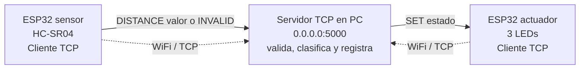
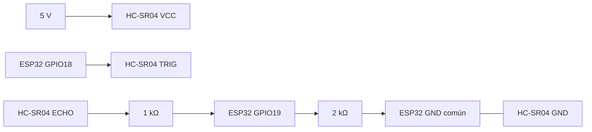
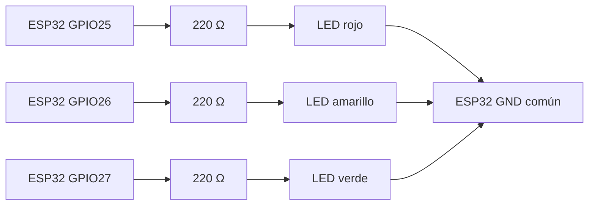
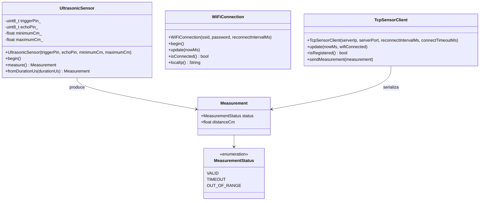

# Diagramas de arquitectura y diseño

> Los diagramas describen la implementación actual, pero no constituyen evidencia de montaje, Unity en placa ni integración física terminada.

## Arquitectura



El servidor es la única autoridad de clasificación. El sensor no envía estados y el actuador no calcula rangos. Los ESP32 usan la IPv4 local configurable de la PC y el puerto 5000; no se conectan a `0.0.0.0`.

## Registro y limpieza de conexión

```mermaid
stateDiagram-v2
  [*] --> SinRegistrar: conexión TCP; servidor inicia en INVALID
  SinRegistrar --> SensorRegistrado: REGISTER SENSOR / OK
  SinRegistrar --> ActuadorRegistrado: REGISTER ACTUATOR / OK + SET estado vigente
  SinRegistrar --> SinRegistrar: comando antes de registro / ERROR INVALID_COMMAND
  SensorRegistrado --> SensorRegistrado: DISTANCE o INVALID
  ActuadorRegistrado --> ActuadorRegistrado: ACK del estado aplicado
  SensorRegistrado --> SensorRegistrado: REGISTER repetido o mensaje de rol incorrecto / ERROR INVALID_COMMAND
  ActuadorRegistrado --> ActuadorRegistrado: REGISTER repetido, mensaje de rol incorrecto o ACK inválido/no coincidente / ERROR INVALID_COMMAND
  SinRegistrar --> SinRegistrar: rol ya ocupado / ERROR INVALID_COMMAND
  SensorRegistrado --> [*]: cierre / liberar SENSOR, estado INVALID inmediato, SET INVALID
  ActuadorRegistrado --> [*]: cierre / liberar ACTUATOR
```



Los comandos no autorizados no ejecutan acción. Un mensaje de rol incorrecto, como `DISTANCE` desde ACTUATOR o `ACK` desde SENSOR, devuelve `ERROR INVALID_COMMAND`, se registra y mantiene la conexión. `ACK` válido es solo diagnóstico y puede corresponder a una publicación anterior. Al liberar un rol, una futura conexión puede registrarlo; un actuador nuevo recibe el estado vigente, que es `INVALID` al iniciar el servidor. Se acepta `\n` o `\r\n`; cada línea tiene máximo 128 bytes. Al excederlo se descarta hasta `\n`, se devuelve `ERROR INVALID_FORMAT` y se conserva la conexión.

## Circuito técnico del sensor



Conexión obligatoria de ECHO: **ECHO → 1 kΩ → GPIO19** y **GPIO19 → 2 kΩ → GND**. El VCC del HC-SR04 es 5 V y todas las tierras deben compartir GND.

## Circuito técnico del actuador



Los cátodos de los tres LEDs se conectan a GND. Este esquema es de diseño y deberá verificarse físicamente antes de la demo.

## Secuencia TCP y estado seguro

```mermaid
sequenceDiagram
  participant S as ESP32 sensor
  participant SV as Servidor TCP
  participant A as ESP32 actuador
  S->>SV: REGISTER SENSOR\n
  SV-->>S: OK\n
  A->>SV: REGISTER ACTUATOR\n
  SV-->>A: OK\n + SET estado vigente\n
  S->>SV: DISTANCE valor\n / INVALID\n
  SV->>SV: validar y clasificar (solo servidor)
  SV-->>A: SET DANGER|WARNING|SAFE|INVALID\n
  A-->>SV: ACK estado\n
  Note over A,SV: ACK confirma idempotentemente el estado aplicado; solo logs/diagnóstico, sin retransmisión ni transición
  Note over SV,A: Publicación periódica del estado vigente cada 200 ms
  Note over SV,A: Sin datos del sensor por 1 s: SET INVALID\n
  Note over A: Sin SET por 1,5 s: INVALID local y LEDs apagados
  S->>SV: mensaje malformado\n
  SV-->>S: ERROR INVALID_COMMAND|INVALID_DISTANCE|INVALID_FORMAT\n
  Note over SV: registra; no actúa; conserva conexión
  S-xSV: cierre de SENSOR
  SV->>SV: libera SENSOR e invalida inmediatamente
  SV-->>A: SET INVALID\n
```

## Clases implementadas del sensor



`UltrasonicSensor` corresponde solo a la adquisición local del HC-SR04: genera TRIG, lee ECHO con timeout explícito de 30 ms, convierte `duración_us / 58.0` y valida el rango inclusivo 2–100 cm. `WiFiConnection` mantiene la asociación WiFi y `TcpSensorClient` registra el rol y serializa las mediciones. `main.cpp` coordina ambas clases mediante el estado `wifiConnected`; por eso no existe una dependencia directa entre ellas. El sensor no clasifica estados. El cliente TCP del actuador está implementado; su validación en placa sigue pendiente.
